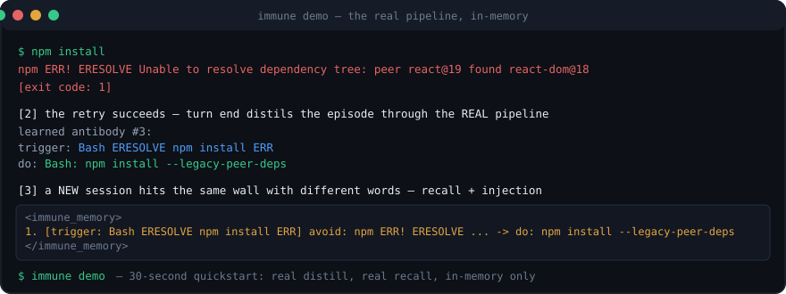

<div align="center">
  <picture>
    <source media="(prefers-color-scheme: dark)" srcset="docs/logo-dark.svg">
    
  </picture>

  <p><b>Your coding agents stop re-debugging what they already fixed.</b></p>

  <p>
    <a href="https://www.npmjs.com/package/dsh-immune-system"></a>
    <a href="https://github.com/meat-daemon-404/dsh-plugin-immune/actions/workflows/ci.yml"></a>
    
    
    
    <a href="https://dsh-plugin.org/plugins/meat-daemon-404/dsh-plugin-immune"></a>
  </p>

  <p><b>English</b> | <a href="README.zh-CN.md">简体中文</a></p>
</div>

When a tool call fails and the next attempt fixes it, the plugin saves that pair as a rule. Rules that match the current work get injected into context on later runs, before the agent repeats the same mistake.

One `core/` engine: **DSH** and **ZCode** install natively (plugin bundles, checked against the real host contracts), and `immune connect` wires the same engine into **Claude Code** and **Codex CLI** as plain hooks — no plugin system required.

<div align="center">
  
</div>

### Quick demo

Runs the whole pipeline in memory, installs nothing, writes nothing:

```bash
npx dsh-immune-system@latest demo
```

It distills a failure→success episode, recalls it from a paraphrased prompt, and prints the `<immune_memory>` block the hooks inject.

### Install

**DSH** — from npm (prebuilt, no toolchain):

```bash
dsh plugin --profile <profile> add dsh-immune-system
```

Same package from a tarball or from git:

```bash
cd dsh-immune-system && npm pack        # prints the exact dsh-immune-system-<version>.tgz it wrote
dsh plugin --profile <profile> add ./dsh-immune-system-<version>.tgz
dsh plugin --profile <profile> add github:meat-daemon-404/dsh-plugin-immune
```

The `github:` form builds at install time through `prepare`, which pnpm blocks until it is allowlisted (the Chinese README has the exact setting). npm or the tarball sidesteps that.

Restart DSH afterwards; plugin bundles are composed at startup.

**ZCode** — this repository is itself a marketplace source:

```bash
node "<zcode.cjs>" plugins marketplace add meat-daemon-404/dsh-plugin-immune
node "<zcode.cjs>" plugins install dsh-immune-system@dev-dsh-plugin-immune
```

Start a new task afterwards; existing tasks keep the capability catalog they started with.

### Hooking Claude Code & Codex

Native plugin installs are for DSH and ZCode. For Claude Code and Codex CLI the
same engine installs as plain hooks — no plugin system required:

```bash
npx dsh-immune-system@latest connect claude-code   # writes ~/.claude/settings.json
npx dsh-immune-system@latest connect codex         # writes ~/.codex/hooks.json
```

What it does: merges six hook entries (five on Codex, which has no
`PostToolUseFailure` event) into the host's own config, leaving every other
setting alone; keeps a one-time `.bak-immune` backup of the file before the
first write; re-running is a no-op; `connect <host> --remove` takes only the
immune entries back out. Bare `connect` surveys both hosts read-only. The
commands point at the npm-installed dist scripts, and the hook payload contract
is the one the ZCode adapter already speaks (same `hookSpecificOutput`
injection shape), so no adapter code ships per host.

Two notes: restart the host session after connecting, and **Codex requires
running `/hooks` inside Codex once to trust the commands** before they fire.

### After installing: what you should see

Run the self-check first; it is the same command support will ask you for:

```bash
immune doctor
# ZCode, when the slash command is not wired yet:
node "<plugin root>/dist/zcode/src/cli.js" doctor
```

The checks cover Node ≥ 22.5, an FTS5 trigram probe (plus the two-character-CJK fallback), both databases, the marker file, the MCP script, the native-UI contract, the counters, and rule hygiene (duplicate or same-symptom groups, with the command to review them). Non-zero exit means the next session will be missing something; advisory rows never turn it red, so a historical LLM fallback cannot train you to ignore the exit code.

Then, plainly, what is proven and what is not:

* **Hooks** — verified against the real DSH event bus and the real ZCode hook lifecycle (`scripts/verify-live-host.mjs`, `scripts/verify-client-serve.mjs`).
* **The ZCode settings tab** — mounted and serving `/plugins/<id>/client.js`; it has not been driven end-to-end in a browser here. If it does not appear, the data is still reachable through `immune list` and `immune ui`.
* **External LLM distillation** — works against one real OpenAI-compatible endpoint (SenseNova). Other providers share the code path but are untested. Without `IMMUNE_LLM_BASE_URL` and `IMMUNE_LLM_MODEL` the deterministic rule path runs and the model counters stay at zero. `node scripts/verify-llm.mjs` is the one-command check when you have an endpoint.
* **`IMMUNE_GUARD=warn` is ZCode-only.** On DSH a configured guard still **denies**: the host contract offers allow/deny/ask with no advisory mode. Keep `IMMUNE_GUARD=off` (the default) if you do not want denial.

### Sharing what it learned

```bash
immune export 5                     # SKILL.md, only rules injected at least 5 times
immune export 3 ./docs/pitfalls.md  # choose the path
```

```markdown
---
name: project-pitfalls
description: Pitfalls this project already paid for once … 11 proven rules.
---

| 触发 / Trigger | 错误直觉 / Wrong instinct | 正确做法 / Do this instead | 命中 / Hits |
| --- | --- | --- | --- |
| Edit old_string-not-found 精确匹配 | old_string 与文件实际内容不一致 | Edit: 重新 Read 后精确复制待替换文本 | 234 |
| EPERM mkdir 只读目录 模型测试 | 在只读目录建 .dsh 或文件报 EPERM | 换可写工作目录，或用 IMMUNE_DB_PATH 显式指定库路径 | 37 |
| … | … | … | … |
```

The dashboard's `/api/export?format=json` produces a snapshot that `immune import` reads back, so a team can start from one person's proven rules.

### When a rule reads like a command dump

The deterministic path cannot write advice: with no repair evidence beyond the command that worked, its prescription IS that command. Six of the thirteen rules in the maintainer's own library were 100–200 characters of shell, and they accounted for half of all deliveries. `immune rewrite` hands each one to the configured model and replaces the wording in place, keeping the trigger, the symptom and the counters:

```bash
immune rewrite --dry-run     # list candidates, change nothing
immune rewrite --max 3       # rewrite three of them
immune rewrite --id 49,50    # re-do specific rules
```

Rewritten rules carry `prescription_source = 'llm'`, so captured evidence and model-written wording stay distinguishable in the database. A model will sometimes follow a stale symptom instead of the command — several production rules shared one generic symptom — so the prompt says the command wins, and a rule whose purpose cannot be told from its input is skipped rather than guessed. Rewriting needs a model by design; there is nothing deterministic to say that the original pass did not already say.

### When the same lesson exists twice

Near-identical rules are merged on insert, but a rewrite or a model switch can leave two wordings of one lesson apart. `immune consolidate` finds pairs that share a normalized symptom, a tool and a trigger token and whose prescriptions are ≥70% similar; it previews before touching anything:

```bash
immune consolidate --dry-run   # pairs, plus same-symptom groups it will NOT merge
immune consolidate             # keep the most proven wording, retire the rest
```

The keeper keeps its wording and absorbs the other's trigger tokens, hit and fail counts, repair actions and per-model attribution; duplicates are retired, not deleted. Groups that share only a symptom are printed for manual review and never merged automatically — in this project's own library five rules taught one lesson in five wordings, and the best pairwise score was 65%.

### Where the library is blind

`immune stats` describes what happened to the rules; it says nothing about the failures no rule matched. `immune coverage` replays the host's error rows over a window, asks the read-only retrieval path whether a rule plausibly applies (the same relevance test anti-rot uses), and groups the misses:

```bash
immune coverage --days 30 --top 8
```

The first version of this counted any FTS hit as coverage and reported 99% for an eight-rule library — obviously false, so it now requires a shared, meaningful token. On this machine the honest number was **21%** of 494 judgeable failures (79 cancelled/policy/network failures are ignored as noise), with two dominant blind spots: 80× `file has not been read yet` (no rule existed) and 54× `file has been modified since read` (the rule existed, its trigger just never matched that wording). Widening that trigger and seeding the missing precondition lesson took it to **52%** without inventing anything. The remaining clusters are environment-specific blocks with no single lesson, which is what the report should show rather than hide.

### Backups

```bash
immune backup [path]   # default: <db>.<date>.bak.sqlite
```

The database runs in WAL mode, so `cp immune.sqlite backup` can copy a file that opens empty — it did, during this project's own release work. The command uses node:sqlite's backup API, which reads through the log and writes one consistent snapshot.

### Syncing into AGENTS.md / CLAUDE.md

Agents that do not run these hooks still read the project docs, so learned rules can be exported into them:

```bash
immune sync-doc                        # AGENTS.md, or CLAUDE.md when that is the convention
immune sync-doc --out CLAUDE.md --min-hits 5
```

Rules land between `<!-- immune:generated -->` markers. Everything outside them is left alone, angle brackets inside rules are stripped, and re-running rewrites the block instead of appending.

To do that automatically after each turn's distillation:

* `IMMUNE_SYNC_DOC=AGENTS.md` (or `1` for the default target)
* `IMMUNE_SYNC_DOC_MIN_HITS=3` (rules below this hit count are not exported)

### Benchmarks and CI

Every push runs the retrieval gate and unit suite on Node 22 and 24:

* **Test suite** — `npm test` runs **138 tests**, 0 failures. `scripts/verify-*.mjs` add 15 + 24 + 20 host-level assertions, and `verify-installed.mjs` adds 22 against your installed profile. Those are the numbers you can reproduce locally.
* **Recall** — fixed zh/en matrix with 8 paraphrased positives and 6 gram-clean negatives. Current: R@1 100%, R@3 100%, FP 0%. CI fails below R@3 7/8 or above FP 1/6.
* **Index and query speed** (`scripts/bench-scale.mjs`) — 300 rules index in 41 ms (0.14 ms/rule); 67 matches run at p50 0.38 ms, p95 0.75 ms.
* **Hook latency** (`scripts/bench-tool-latency.mjs`) — the tool path never calls a model; distillation is paid at the turn boundary.
* **Live LLM check** (`scripts/verify-llm.mjs`) — one command against a configured endpoint, when there is one.

### Comparison

|  | dsh-plugin-immune | [deja-vu](https://github.com/vshulcz/deja-vu) | [mem0](https://github.com/mem0ai/mem0) | [claude-memory-compiler](https://github.com/nicobailon/claude-memory-compiler) |
| --- | --- | --- | --- | --- |
| Keeps | failure→success pairs distilled into rules | full session transcripts | conversation facts | compiled skill files |
| Delivery | injected before the repeat, via hooks | search on demand (MCP/TUI) | SDK-level recall | skill file, read by the model |
| Dependencies | none (`node:sqlite` FTS5) | one Go binary | Python + store | Node |
| Hosts | DSH, ZCode native; Claude Code & Codex via `connect` | Claude Code, Codex, Cursor, 36+ | any via SDK | Claude Code |

Different jobs, mostly: deja-vu indexes everything you did and searches it; this keeps the lessons and pushes them in unasked.

### Design notes

**Outcome detection.** A non-zero exit is not an error result on either host: ZCode only fires `PostToolUseFailure` when a handler throws, and DSH reports non-zero exits rather than flagging them. Both adapters therefore classify the result themselves, in this order: structured `value.exitCode`; `isError` or an `error` payload; a trailing `[exit code: N]` / `[killed by signal: X]` / timeout marker; and a narrow marker regex. A structured payload with no exit status counts as success and its text is not scanned, so reading a log that mentions `Error:` stays a success.

**Pairing.** A failure only pairs with a success that is the same kind of work: same file for file tools, same program family for commands (`npm`, `npx`, `pnpm` are one family; `npm …` then `git …` is not). Read-only probes — `ls`, `cat`, `git status`, `git diff`, `which` — never close an episode, because they cannot have fixed anything.

**Merging and decay.** Prescriptions are compared with character-3-gram Jaccard (blended with a character-set score for short CJK sentences, where one inserted character shifts every trigram). At ≥0.70 the rule merges into the existing row, and its trigger tokens are unioned so each rewording widens recall. An injected rule that still fails three times is retired; the penalty is relevance-guarded so a `Bash …` rule is not blamed for an unrelated Bash failure.

**Retrieval.** FTS5 trigram for 3+ characters, plus a bound LIKE pass for two-character Chinese words that trigram cannot index. Candidates are re-ranked with ×1.5 for a path the prompt mentions, ×0.85 for shared-library rules, and a `1 / (1 + 0.02 × days)` decay.

**Which model.** The hook payload carries `session_id`, not a model. The host does record it — one `model_usage` row per request — so a delivery reads the session's latest model (read-only, bound parameters, ~6 ms) and re-asks every 30 s. That window is deliberate: on this machine one session used GLM-5.3-Flash 1,395 times and auto/deepseek-v4.1-flash 1,248 times, so a session-long cache would have credited every later rule to whichever model answered first. The dashboard shows deliveries per model, and rules that held under more than one model are counted as cross-model proof — the measurable form of "this prescription is a general action, not one model's tic". `IMMUNE_MODEL_NAME` overrides the lookup for other hosts.

**What it saved.** `immune stats` multiplies suppressed repeats by two round-trips (the failing attempt and the retry that did not happen) and by the median tokens of this project's own completed requests, then prints all three inputs. It deliberately does not print dollars: pricing differs per model, some models are unpriced, and cache effects are not observable from inside the tool.

**Injection and cost.** Injected text comes only from distilled fields, brackets stripped so a line cannot close the wrapper tag, capped in length and labelled advisory. The same candidate set is not re-injected within four turns, and skipped turns do not count as hits. Distillation is queued during tool use and drained at turn end under `IMMUNE_DISTILL_BUDGET_MS` (12 s default, batched four episodes per request).

For the full list of decisions and the ones that were tried and reverted, read [AGENTS.md](AGENTS.md).
