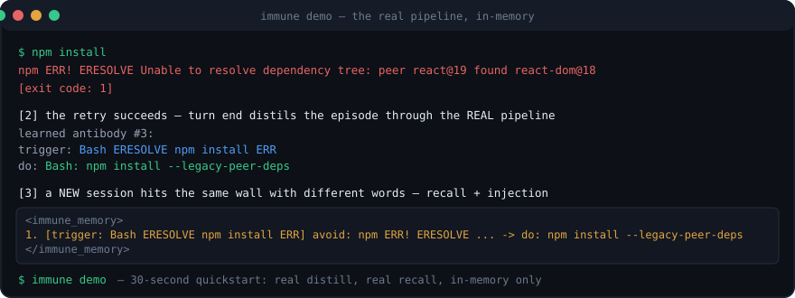
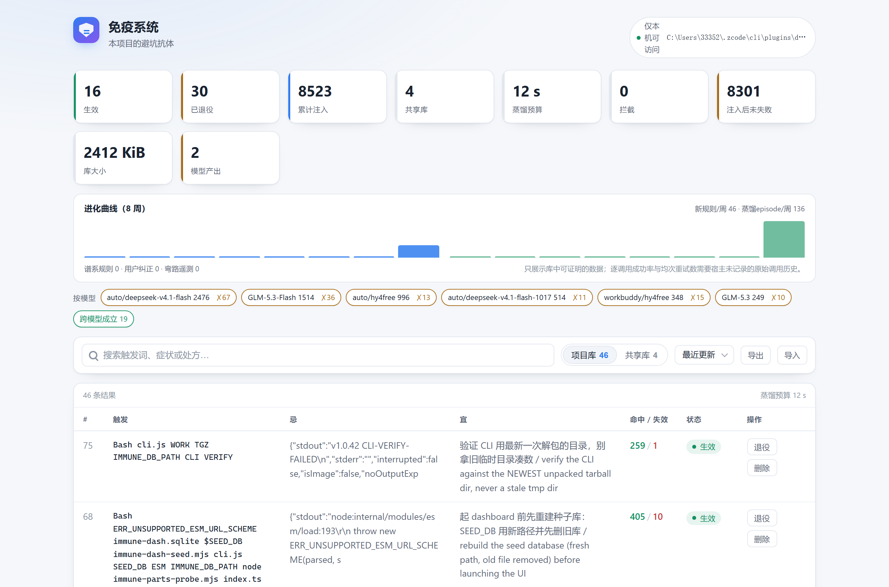

<div align="center">
  <picture>
    <source media="(prefers-color-scheme: dark)" srcset="docs/logo-dark.svg">
    
  </picture>

  <p><b>让 coding agent 别再重复调试自己已经修好的问题。</b></p>

  <p>
    <a href="https://www.npmjs.com/package/dsh-immune-system"></a>
    <a href="https://github.com/meat-daemon-404/agent-immune/actions/workflows/ci.yml"></a>
    
    
    =24">
    <a href="https://dsh-plugin.org/plugins/meat-daemon-404/agent-immune"></a>
  </p>

  <p>
    回放 <b>20,100 次真实工具调用</b>，判定一致率 <b>97.54%</b> · <b>0</b> 假阴性 · <b>零</b>运行时依赖
    <br>
    <sub><a href="#跑分和-ci">数字是测出来的，不是喊出来的——看它怎么来的</a></sub>
  </p>

  <p><a href="README.md">English</a> | <b>简体中文</b></p>
</div>

工具调用报错、下一次调用修好，这两条会被存成一条规则。之后遇到类似场景，匹配上的规则先一步进入上下文，agent 就不会在同一个地方摔第二遍。

只有一个 `core/`：**DSH** 和 **ZCode** 以插件形式原生安装（按真实宿主契约验证过），`immune connect` 还能把同一个引擎以普通 hook 的方式接进 **Claude Code** 和 **Codex CLI**——不依赖任何插件系统。

<div align="center">
  
  
  <p><sub>任何安装都会看到这样的仪表盘——截图用的是演示规则，不是私人库。</sub></p>
</div>

### 先跑三十秒

不装东西、不写任何文件，全程内存里跑：

```bash
npx dsh-immune-system@latest demo
```

它会真的蒸馏一条失败→成功的记录，用一句换了说法的提问去召回，然后把 hook 实际会注入的 `<immune_memory>` 打印出来。这台机器上已经有历史？`npx dsh-immune-system@latest audit --dry-run` 会读它，并展示能学到什么。

### 装

**DSH**，从 npm 装（有预构建产物，不用本地编译）：

```bash
dsh plugin --profile <profile> add dsh-immune-system
```

想用 tarball 或直接从 git 装：

```bash
cd dsh-immune-system && npm pack        # 会打印它写出的 dsh-immune-system-<version>.tgz 文件名
dsh plugin --profile <profile> add ./dsh-immune-system-<version>.tgz
dsh plugin --profile <profile> add github:meat-daemon-404/agent-immune
```

`github:` 这种方式会在安装时跑 `prepare`，pnpm 10 默认拦构建脚本，得先 `pnpm approve-builds` 把 `dsh-immune-system` 加进 `onlyBuiltDependencies`。不想折腾就用 npm 或 tarball。装完记得重启 DSH —— 插件 bundle 是启动时组装的。

**ZCode**，这个仓库本身就是市场源：

```bash
node "<zcode.cjs>" plugins marketplace add meat-daemon-404/agent-immune
node "<zcode.cjs>" plugins install dsh-immune-system@dev-dsh-plugin-immune
```

装完开新任务；老任务还拿着它启动时的能力清单。

### 接入 Claude Code 和 Codex

原生插件安装只覆盖 DSH 和 ZCode。Claude Code 和 Codex CLI 走的是普通 hook——同一个引擎，不依赖插件系统：

```bash
npx dsh-immune-system@latest connect               # 自动探测本机装了哪些宿主并逐一接入
npx dsh-immune-system@latest connect claude-code   # 写 ~/.claude/settings.json
npx dsh-immune-system@latest connect codex         # 写 ~/.codex/hooks.json
```

它做的事：把引擎复制到固定的 `~/.dsh-immune/` 安装位（这样钩子不随 npx 缓存清理或包升级而失效），往宿主自己的配置里合并 hook 条目（Codex 五个——它没有 `PostToolUseFailure` 事件，Claude Code 六个）并指向该固定副本，用户的其它配置一概不动；首次写入前留一份 `.bak-immune` 备份；重复执行是空操作（`--refresh` 强制重灌）；旧版 connect 留下的 npx 缓存路径会被原地升级；`connect <host> --remove` 只摘走 immune 的条目，最后一个宿主卸载时顺带删除 `~/.dsh-immune/`。不带宿主参数的 `connect` 会探测这台机器实际装了哪些宿主（`~/.claude`、`~/.codex`）并逐一幂等接入——ZCode 也会被探测到，但只报告不写入，因为 ZCode 走自己的插件市场安装。`connect --status` 保留只读巡检；`immune doctor` 会对失效的钩子路径报警并给出修复命令。hook 载荷契约就是 ZCode 适配器已经在说的那套（同样的 `hookSpecificOutput` 注入格式），所以不需要按宿主另写适配代码——而且 vendor 运行时已在**零宿主环境变量**下端到端验证过（`scripts/verify-connected-runtime.mjs`）：库经回退链落位、事件在回合末蒸馏、新会话拿到注入；连 Codex 原生的 `shell_command` / `apply_patch` 工具名序列（映射回引擎的 Bash/Edit 词汇）也跑过；六个 hook 事件、人工纠偏挂载、注入分隔符对伪造闭合标签的隔离、guard deny 分支，以及**一个会话踩的坑由新会话在项目 30 分钟窗口内闭合**，都在 `scripts/verify-connected-runtime.mjs` 的 25 条断言里。仍未覆盖的：真实宿主 CLI 自身的分发。

两个提醒：接完重启宿主会话才生效；**Codex 需要先在 Codex 里跑一次 `/hooks` 信任这些命令**，否则不会执行。

### 体检：用你已有的历史冷启动

刚装完的库是空的。`immune audit` 把活体配对循环原样重放到这台机器已有的会话历史上——ZCode 的会话库、Codex 的 rollout 文件（`~/.codex/sessions`）、Claude Code 的转录（`~/.claude/projects`，含嵌套的子代理转录；工具结果没带 `is_error` 标记时回退读 `Exit code:` 文本标记）——打印一份可截图分享的摘要（按工具的失败计数、最高频的重复坑点、有用量记录时的可省 token 估算），然后把这些历史蒸馏成你自己最早的一批规则：

```bash
npx dsh-immune-system@latest audit --dry-run   # 只出报告，不写库
npx dsh-immune-system@latest audit             # 报告 + 蒸馏（配了 LLM 就走模型）
```

缺席也是明说的：某个源在这台机器上没有历史，就打印自己那一行。Codex rollout 格式和 ZCode 库结构对过真实文件；Claude Code 转录解析器目前只有夹具测试——等它见过一次真实安装再转正，报告里每次都会注明这一点。跑不了钩子的 agent（Cursor、Cline 等）走 MCP 拿同一份报告：`immune_audit` 是只读预览（写入版留在终端——MCP 宿主没有回合末 drain），`immune_seed_packs` 列出种子包。

### 种子包

不是每个坑你都踩过。四套手工编写的规则包——与内置通用教训同一信任等级，**不是**模型输出——走正常 insert 路径安装，你已经学过的同文规则会合并而不是重复：

```bash
npx dsh-immune-system@latest seed            # 列出所有包
npx dsh-immune-system@latest seed git-safety # 装一套（6 条）
npx dsh-immune-system@latest seed git-safety --remove  # 卸载
```

卸载是保守的：agent 已经命中过的、或你改写过措辞的种子规则会被保留——它们现在承载的是你自己的证据。现有包：`git-safety`、`node-ts`、`python-uv`、`docker`。每条发布出去的规则都受 `scripts/bench-seed-recall.mjs`（也在 CI 里）约束：用换过说法的用户提问必须能在 top-3 召回它——当前 R@3 100%、零误报。

### 装完先自检：该看到什么，没看到查什么

先跑自检，出问题时客服（以及你自己）第一句就会问这个：

```bash
immune doctor
# ZCode 斜杠命令还没生效时：
node "<插件根目录>/dist/zcode/src/cli.js" doctor
```

检查项包括：包的 Node engine（`^22.19 || >=24`，node:sqlite 的门槛）、FTS5 trigram 探针（含两字中文的兜底）、项目库和共享库、marker 文件、MCP 脚本、原生 UI 契约、各项计数，以及规则卫生（重复规则、同 symptom 但未达合并线的组，并给出复核命令）。非零退出说明下一个会话会缺东西；提示类检查永远不会把退出码变红——不然几个月前一次模型降级会让你永远忽略这个退出码。

然后，摊开说哪些验过、哪些没验：

* **hook** —— 在真实的 DSH 事件总线和 ZCode 的 hook 生命周期上验过（`scripts/verify-live-host.mjs`、`scripts/verify-client-serve.mjs`）。
* **ZCode 的设置页 tab** —— 能挂载、能服务 `/plugins/<id>/client.js`；但没在浏览器里端到端点过。要是它没出现，数据本身还能从 `immune list` 和 `immune ui` 里看到。
* **外部 LLM 蒸馏** —— 在一条真实的 OpenAI 兼容端点上跑通过（商汤 Token Plan）。别的厂商走同一份代码，但没实测。不配 `IMMUNE_LLM_BASE_URL` 和 `IMMUNE_LLM_MODEL` 就走确定性规则路径，模型计数保持为 0。有端点时用 `node scripts/verify-llm.mjs` 一条命令验。
* **`IMMUNE_GUARD=warn` 只有 ZCode 支持。** DSH 侧配了 guard 照样**会拦**：宿主契约只给 allow / deny / ask，没有「仅提醒」这一档。不想被拦就保持默认的 `IMMUNE_GUARD=off`。

### 规则写成了命令怎么办

确定性路径写不出建议：只有一条"跑通了的命令"当证据，处方就只能是那条命令本身。维护者自己的库里，13 条规则有 6 条是 100–200 字符的 shell，占了全部投递的一半。`immune rewrite` 把它们交给配置好的模型，原地换掉措辞，触发词、症状和计数都不动：

```bash
immune rewrite --dry-run     # 只列候选，一个字不改
immune rewrite --max 3       # 改三条
immune rewrite --id 49,50    # 重做指定的几条
```

被重写的规则会带 `prescription_source = 'llm'`，所以"抓到的证据"和"模型写的措辞"在库里分得清。模型有时会顺着过期的 symptom 编而不是看命令——生产库里好几条规则共用一个泛化 symptom——所以 prompt 明说以命令为准，说不清用途的直接 skip，不许猜。这个功能必须有模型：确定性路径再来一遍，只会得到同样一条命令。

### 同一课在库里出现了两次

插入时会合并近似规则，但一次重写或一次换模型，可能让同一课留下两种措辞。`immune consolidate` 只找这种配对：symptom 归一化后相同、同一个工具、触发词有交集，且处方相似度 ≥70%。动手前先预览：

```bash
immune consolidate --dry-run   # 列出可合并的配对，以及「同 symptom 但不会自动合并」的组
immune consolidate             # 保留命中更多的那条措辞，其余退役
```

保留者接过来自对方的触发词、命中/失败计数、修复动作和按模型归因；被合并的规则退役而不是删除。只有 symptom 相同的组只会打印出来供人工复核，绝不自动合并——维护者自己的库里，五条规则用五种措辞讲同一课，最高相似度只有 65%。

### 库的盲区在哪

`immune stats` 说的是规则发生了什么，完全没说**没有规则命中的失败**。`immune coverage` 把宿主的错误行按时间窗回放一遍，走只读检索问一句“有没有一条规则真的适用”（用的就是反腐蚀判定），再把漏掉的按签名聚类：

```bash
immune coverage --days 30 --top 8
```

第一版把所有 FTS 命中都算覆盖，八条规则的库报出 99%——明显是假的。现在一条规则必须共享有意义的词、属于同一个工具、而且真的相关，才算覆盖。报告给三个数字，因为它们回答三个不同问题：

```
coverage: last 30 days · 505 judgeable failure(s) · 381 known (75%) · 105 still injected · 124 uncovered · 79 ignored as noise
  276 failure(s) match a retired rule: the advice exists but is not injected
```

`known` 是「库里有规则提到这件事」（任何状态，宽松上界），`still injected` 是「模型真的会收到警告」，`uncovered` 才是真盲区。三者的差很重要：这份报告促成的「先 Read 再 Edit」规则，注入 3 次、失败 3 次，被反腐蚀退役了——覆盖率随即又把这条教训报成盲区，既不真实也不可行动。看到「知道但没注入」，才知道该恢复哪条规则。剩下的未覆盖簇是 Mimosa 拦截这类每次原因不同的环境失败，报告如实列出来比藏起来有用。

### 备份

```bash
immune backup [路径]   # 默认 <库>.<日期>.bak.sqlite
```

数据库是 WAL 模式，`cp immune.sqlite backup` 复制出来的文件可能打开是空的——本项目发版过程中真的踩到过。这条命令走 node:sqlite 的 backup API，会穿过 WAL 写出一个完整快照。

### 把学到的东西分享出去

```bash
immune export 5                     # 导出 SKILL.md，只收命中 ≥5 次的
immune export 3 ./docs/pitfalls.md  # 自己指定路径
```

```markdown
---
name: project-pitfalls
description: 本仓库踩过的坑 … 11 proven rules.
---

| 触发 / Trigger | 错误直觉 / Wrong instinct | 正确做法 / Do this instead | 命中 / Hits |
| --- | --- | --- | --- |
| Edit old_string-not-found 精确匹配 | old_string 与文件实际内容不一致 | Edit: 重新 Read 后精确复制待替换文本 | 234 |
| EPERM mkdir 只读目录 模型测试 | 在只读目录建 .dsh 或文件报 EPERM | 换可写工作目录，或用 IMMUNE_DB_PATH 显式指定库路径 | 37 |
| … | … | … | … |
```

仪表盘的 `/api/export?format=json` 导出的快照能被 `immune import` 读回，团队可以从某个人的成熟规则起步。导出有闸门：规则里还带着机器路径或密钥形状的文本时**导出直接失败**，而不是把问题带给团队——脱敏在捕获时清洗 trace，这道闸检查的是规则本身。

### 遥测：弯路、进化曲线和 CI 闸门

不是所有值得知道的事都会变成规则。剩下的一半有三块面板：

```bash
immune detours                    # 同一目标探测 4+ 次才修好的弯路记录
immune stats                      # 含 5+ 条同课规则的"睡眠评审"簇，等 `immune consolidate`
immune ci-check --diff pr.diff    # 拿 PR 新增行扫本仓库已提交的 AGENTS.md 托管块
```

`immune detours` 只是遥测——确定性路径绝不会从它蒸馏"捷径规则"（那只能是回声命令；写规则走 `immune rewrite`）。`immune ci-check` 刻意无状态：CI 里没有免疫库，它读的是仓库已经提交的 `<!-- immune:generated -->` 托管块，新增行碰到某条规则的触发领地就 exit 1（`--json` 供机器读）。仪表盘（`immune ui`）多了进化条带：每周新规则/episode 直方图，加谱系、来源、probation 和弯路计数——只展示库能证明的数据。`immune doctor` 用一行 advisory 报告同一份生命周期状态。

1.1 给循环本身加的东西：对无规则覆盖的目标第三次尝试前，会注入一次结构化诊断提示（"先读报错第一行、查 --help/版本、看锁文件和环境变量，确认原因再改参数重试"）；这样找到的修复结晶为 `origin = self_healing_experiment`，被人工纠偏救回的规则带 `origin = user_correction`。环境变更（锁文件内容、Node 主版本）会把旧环境学的规则放入观察期，新环境自己重新学会同一课时将其退役为 `superseded_by_env_upgrade`。每条规则都带出处：哪个工作区教的（`env_fingerprint`）、什么修好的（`repair_path`）、从哪条规则变异来的（`parent_id`）。

### 不跑 hook 的 agent 怎么办

Cursor、Codex 这些不认我们的 hook，但它们都读 `AGENTS.md` / `CLAUDE.md`。所以加了条命令，把成熟的规则写进这些文件：

```bash
immune sync-doc                        # 默认写 AGENTS.md
immune sync-doc --out CLAUDE.md --min-hits 5
```

内容写在 `<!-- immune:generated -->` 标记之间。标记外的内容一个字不动，规则里的尖括号先剥掉再写，重复执行是替换那一段，不会越写越长。

想让它每回合自动同步，开两个环境变量：`IMMUNE_SYNC_DOC=AGENTS.md`（或 `1` 表示用默认目标），`IMMUNE_SYNC_DOC_MIN_HITS=3`（少于三次命中的规则不导出）。

### 跑分和 CI

每次 push 都在 Node 22 和 24 上跑一遍召回闸和单测：

* **失败判定**（`scripts/eval-judge.mjs`）：把 **20,100 次带宿主标注的真实工具调用**回放给判定器——与宿主标注**一致率 97.54%**，**0 假阴性**，495 个假阳性（2.46%）——全部是探针/检查类命令，非零退出本来就是想要的"答案"，宿主因此标注为"完成"。该类别已量化并在 AGENTS.md 决策 #25 接受。
* **单测**：`npm test`（条数随覆盖增长，CI 在 Node 22 和 24 上跑，徽章链接到结果）。`scripts/verify-*.mjs` 另加 15 + 24 + 20 条宿主级断言，`verify-installed.mjs` 对你本机已装的 profile 再加 22 条。本地都能用上面的命令复现。
* **召回**：固定的中英场景矩阵，8 条改述正例、6 条 gram 干净的负例。现在是 R@1 100%、R@3 100%、误报 0%。低于 R@3 7/8 或高于误报 1/6 就红。
* **索引和查询**（`scripts/bench-scale.mjs`）：300 条规则入库 39 ms（每条 0.13 ms）；67 次匹配 p50 0.44 ms、p95 0.75 ms。
* **hook 开销**（`scripts/bench-tool-latency.mjs`）：工具执行路径永远不碰模型，蒸馏的钱花在回合边界上。
* **真机验证 LLM**（`scripts/verify-llm.mjs`）：配了端点就一条命令走通全链路。

### 和别的工具比

|  | agent-immune | [deja-vu](https://github.com/vshulcz/deja-vu) | [mem0](https://github.com/mem0ai/mem0) | [claude-memory-compiler](https://github.com/nicobailon/claude-memory-compiler) |
| --- | --- | --- | --- | --- |
| 存什么 | 失败→成功的配对，蒸馏成规则 | 完整会话记录 | 对话里的事实 | 编译好的 skill 文件 |
| 怎么用上 | 靠 hook，在重蹈之前注入 | 需要时搜索（MCP / TUI） | SDK 层召回 | 模型得主动去读 |
| 依赖 | 无（`node:sqlite` FTS5） | 一个 Go 二进制 | Python + 向量库 | Node |
| 宿主 | DSH、ZCode 原生；Claude Code 与 Codex 走 `connect` | Claude Code、Codex、Cursor 等 36+ | 走 SDK 都行 | Claude Code |

其实是两件不同的事：deja-vu 把你做过的全量索引起来供搜索，这里只留教训，然后不请自来地塞进上下文。

### 实现上几个躲不过去的问题

**怎么判断一次调用失败了。** 两个宿主都不会因为退出码非零就报错：ZCode 的 `PostToolUseFailure` 只有 handler 抛异常才触发，DSH 文档写得很清楚——非零退出是"报告"，不是"错误"。所以两边都自己判，顺序是：结构化 `value.exitCode` 优先；其次是 `isError` 或 `error` 载荷；再其次是尾部的 `[exit code: N]`、`[killed by signal: X]`、超时标记；最后才是窄范围的关键字正则。有结构化载荷但没有退出状态的，一律当成功，正文不扫——不然 grep 一个日志、日志里写着 `Error:`，就被记成一次失败。

**配对的边界。** 失败的调用只跟"同一类活"的成功配对：文件工具看同一个文件，命令看是否同族（`npm`、`npx`、`pnpm` 算一族，所以 `npm` 编译失败换 `npx` 编译成功是同一次修复；`npm …` 后面接 `git …` 不算）。只读探测（`ls`、`cat`、`git status`、`git diff`、`which`）永远不会闭合一次失败——它没可能修好任何东西。

**合并与淘汰。** 处方用字符 3-gram 的 Jaccard 比（中文短句会和字符集相似度取最大值，因为插一个字就把所有 trigram 错位了）。到 0.70 就并进已有那条，同时把新触发词拼进去，所以每换个说法，规则的召回面就宽一点。被注入过却还是没能阻止失败的规则，三次就退役——但前提是这三次至少占它投递量的四分之一。只看绝对次数会把好规则扔掉：生产库里有一条 516 次命中、3 次失败（0.6%）的规则就这样被退役了。偶尔失手的规则是在工作，不是烂了；当初促成反腐蚀的垃圾规则失败率是 50%。扣分仍带相关性门控，免得一条 `Bash …` 规则被无关的 Bash 失败连坐。

**检索。** 三个字以上走 FTS5 trigram，两个字的词（跨域、端口、权限这种）走绑定参数的 LIKE——trigram 根本索引不了两个字。候选再做一次重排：prompt 里提到的路径 ×1.5，来自共享库的规则 ×0.85，时间衰减是 `1 / (1 + 0.02 × 天数)`。

**哪个模型。** hook 的 payload 里只有 `session_id`，没有模型名。但宿主自己是记的——每次请求一行 `model_usage`——所以投递时去读这条会话最新的模型（只读、参数绑定、约 6 ms），且每 30 秒重新问一次。这个窗口是量出来的：本机同一条会话里 GLM-5.3-Flash 用了 1395 次、auto/deepseek-v4.1-flash 用了 1248 次，按会话缓存会把后面所有投递都记到最先回答的模型头上。仪表盘按模型列投递量，被两个以上模型投递过且没失败的规则算"跨模型成立"——这是"处方是通用动作，不是某个模型的毛病"的可测形式。别的宿主可以用 `IMMUNE_MODEL_NAME` 直接指定。

**省了多少。** `immune stats` 用抑制掉的重复次数 × 两次往返（没发生的失败 + 没发生的重试）× 本项目自己已完成请求的 token 中位数，并把三个输入都打出来。它故意不打美元数：不同模型价格不同、有些模型未计价、缓存影响在工具内部根本观测不到。

**注入和预算。** 注入的文字只来自我们自己蒸馏出来的字段，尖括号剥掉（不然一行就能把包装标签提前闭合），长度截断，并且标注是"仅供参考"。同一组候选在四回合内不重复注入，被跳过的那几回合也不计命中数——那个计数驱动晋升和淘汰，灌水会让统计说谎。蒸馏任务在工具调用期间入队，回合末按 `IMMUNE_DISTILL_BUDGET_MS`（默认 12 秒）排空，有模型时一次请求处理四条。

那些做过的决定、以及试过又撤回的改动，都写在 [AGENTS.md](AGENTS.md) 里。
